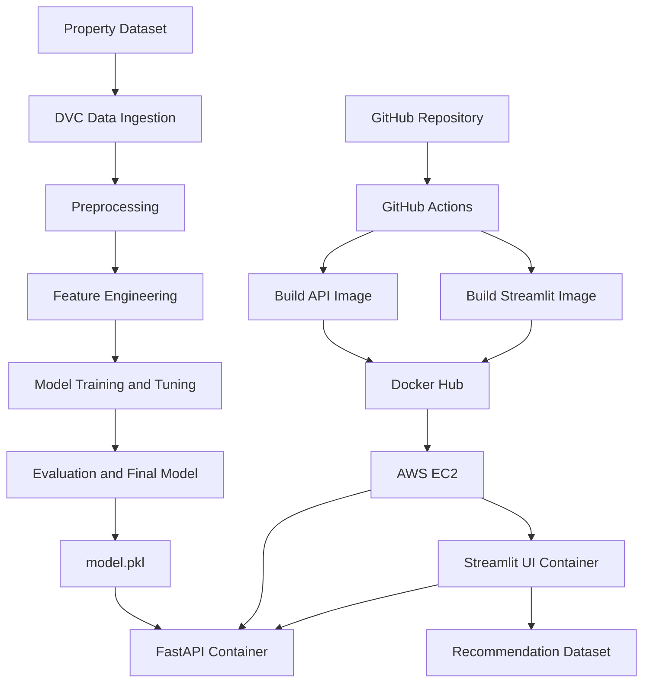

from pathlib import Path

readme = r'''<div align="center">

# 🏙️ Mumbai Real Estate Price Prediction & Recommendation

### An end-to-end Machine Learning and MLOps project

Predict estimated property prices, explore Mumbai real-estate data, and discover suitable property options through a web application.

<br/>


[](https://www.python.org/)
[](https://scikit-learn.org/)
[](https://fastapi.tiangolo.com/)
[](https://streamlit.io/)
[](https://dvc.org/)
[](https://mlflow.org/)
[](https://optuna.org/)
[](https://dagshub.com/)
[](https://github.com/features/actions)
[](https://www.docker.com/)
[](https://aws.amazon.com/ec2/)


**Repository:** [Pratik1017/mumbai-real-estate](https://github.com/Pratik1017/mumbai-real-estate)

**Application:** [Streamlit Web App](http://3.25.61.170:8501/) · **API Docs:** [FastAPI Swagger UI](http://3.25.61.170:8000/docs)

</div>

---

## 📌 Table of Contents

- [Project Overview](#-project-overview)
- [Application Features](#-application-features)
- [How the System Works](#-how-the-system-works)
- [Architecture](#-architecture)
- [Technology Stack and Libraries](#-technology-stack-and-libraries)
- [Machine Learning Concepts](#-machine-learning-concepts)
- [Repository Structure](#-repository-structure)
- [Data and Preprocessing](#-data-and-preprocessing)
- [MLOps Pipeline with DVC](#-mlops-pipeline-with-dvc)
- [Experiment Tracking with MLflow](#-experiment-tracking-with-mlflow)
- [Model Training and Evaluation](#-model-training-and-evaluation)
- [API Documentation](#-api-documentation)
- [Run the Project Locally](#-run-the-project-locally)
- [Docker](#-docker)
- [CI/CD with GitHub Actions](#-cicd-with-github-actions)
- [AWS EC2 Deployment](#-aws-ec2-deployment)
- [Useful Commands](#-useful-commands)
- [Environment Variables and Secrets](#-environment-variables-and-secrets)
- [Limitations and Responsible Use](#-limitations-and-responsible-use)
- [Future Improvements](#-future-improvements)
- [Author](#-author)

---

## 🎯 Project Overview

Mumbai's property market varies considerably by locality, property size, configuration, furnishing, and building characteristics. This project combines a regression model with a simple web interface to help users explore estimated property prices and property recommendations.

The project also demonstrates how a trained ML model can be moved beyond a notebook into an application and deployed using an API, containers, CI/CD automation, and a cloud virtual machine.

### Project goals

1. Prepare property data for machine learning.
2. Build a repeatable data-processing and model-training workflow.
3. Train and evaluate regression models for price estimation.
4. save the trained model as an artifact for inference.
5. Serve predictions through a FastAPI REST API.
6. Provide a user-facing Streamlit application.
7. Track pipeline stages and data dependencies with DVC.
8. Track experiments with MLflow where configured.
9. Package the API and UI using Docker.
10. Automate image build and publishing with GitHub Actions.
11. Run the containers on AWS EC2.

> **Important:** This is an educational/portfolio project. Predictions are estimates, not official property valuations or financial advice. Review the data source, data quality, and final test metrics before relying on a prediction.

## ✨ Application Features

- **Property price prediction:** estimates a property's price from the features accepted by the model/API.
- **Property recommendations:** provides a recommendation/analysis experience through the Streamlit application using the project's dataset.
- **Data preparation pipeline:** separates ingestion, preprocessing, feature engineering, and modeling into stages.
- **Model experimentation:** supports comparing model configurations and hyperparameters.
- **Model artifact:** stores the trained estimator as `model.pkl`.
- **REST API:** exposes prediction functionality through FastAPI.
- **Interactive UI:** lets users interact with the application through Streamlit.
- **Containerized services:** keeps API and UI in separate Docker images.
- **Automated image publishing:** GitHub Actions builds and pushes images to Docker Hub.
- **Cloud deployment:** runs the application containers on AWS EC2.

---

## 🔄 How the System Works

At a high level:

```text
Property Dataset
      |
      v
Data Ingestion (DVC)
      |
      v
Train/Test Split
      |
      v
Data Preprocessing
      |
      v
Feature Engineering
      |
      v
Model Training and Hyperparameter Search
      |
      v
Evaluation and Final Model
      |
      v
       model.pkl
          |
          v
   FastAPI Prediction API <------ Streamlit UI
          |                           |
          +------------+--------------+
                       |
                       v
                Docker Images
                       |
                       v
              GitHub Actions CI/CD
                       |
                       v
                   Docker Hub
                       |
                       v
                 AWS EC2 Server
                       |
                       v
             Live Web App and API
```

### A simple explanation

- **Training pipeline:** prepares the data and creates the model.
- **`model.pkl`:** the saved trained model used during prediction.
- **FastAPI:** receives prediction inputs and returns a response.
- **Streamlit:** provides the browser interface.
- **Docker:** packages each app with its runtime dependencies.
- **GitHub Actions:** builds and publishes images after repository changes.
- **Docker Hub:** stores the built images.
- **AWS EC2:** runs the containers on a cloud server.
- **DVC:** records the data/model pipeline stages and their dependencies.
- **MLflow:** records experiments and metrics when tracking is enabled.

## 🏗️ Architecture



The diagram describes the intended high-level workflow. Exact runtime communication depends on the API URL and container configuration used by the deployed version.

---

## 🧰 Technology Stack and Libraries

The repository's `requirements.txt` contains a large pinned dependency list. The table below highlights the main tools and libraries relevant to the project; not every transitive dependency is listed.

| Tool / library | Purpose |
|---|---|
| **Python 3.12** | Main programming language and application runtime |
| **Pandas** | Tabular data loading, cleaning, and manipulation |
| **NumPy** | Numerical operations and array handling |
| **Scikit-learn** | Preprocessing, regression estimators, model selection, and evaluation |
| **XGBoost** | Gradient-boosting estimator available in the environment/project |
| **Optuna** | Hyperparameter optimization library available in the environment |
| **Matplotlib / Seaborn / Plotly** | Data visualization and exploratory analysis |
| **FastAPI** | REST API for model inference |
| **Uvicorn** | ASGI server used to run FastAPI |
| **Streamlit** | Interactive browser-based application |
| **Pydantic** | Request/data validation used by FastAPI applications |
| **DVC** | Data/model pipeline stages, dependencies, and reproducibility |
| **MLflow** | Experiment tracking and model-related logging where configured |
| **DagsHub** | Remote collaboration/tracking integration where configured |
| **Git / GitHub** | Version control and source-code hosting |
| **GitHub Actions** | Automated build and publish workflow |
| **Docker** | Container images and isolated application runtime |
| **Docker Hub** | Container image registry |
| **AWS EC2** | Cloud virtual machine used to host the application |
| **Joblib / pickle** | Serialization formats used to persist Python model artifacts |
| **PyYAML** | Reading YAML configuration such as `params.yaml` and `dvc.yaml` |

### Infrastructure components

- **`Dockerfile.api`** builds the API image, copies `api/` and `model.pkl`, and exposes port `8000`.
- **`Dockerfile.streamlit`** builds the UI image, copies `streamlit_app/` and `data/base-file/`, and exposes port `8501`.
- **`dvc.yaml`** defines the model-building stages and their dependencies.
- **`params.yaml`** stores configurable pipeline parameters.
- **`.github/workflows/`** contains CI/CD workflow definitions.
- **`requirements.txt`** pins Python package versions for repeatable installation.

> The requirements file includes tools for multiple parts of the project, including development and MLOps. For smaller production images, a future improvement would be to split runtime dependencies from training/development dependencies.

---

## 🧠 Machine Learning Concepts

### 1. Regression

This is a **regression problem** because the target is a continuous property price rather than a class label.

### 2. Train/test split

Data is divided into training and testing subsets. The training data is used to fit the model; the test data is reserved for final evaluation.

### 3. Data preprocessing

Data preparation can include:

- handling missing values;
- correcting data types;
- removing irrelevant or leakage-prone columns;
- encoding categorical features;
- preparing consistent input features for the model.

The exact transformation sequence is defined by the scripts in `src/` and the saved model/inference implementation.

### 4. Feature engineering

Feature engineering transforms raw columns into a format that is more useful for learning. This project has a dedicated feature-engineering stage in the DVC pipeline.

### 5. Categorical encoding

Machine-learning estimators generally need numerical inputs. Categorical features can be encoded using techniques such as one-hot encoding. The training and inference stages must apply compatible transformations.

### 6. Baseline modeling

A baseline provides a reference score before choosing or tuning a final estimator. It helps establish whether later model changes improve performance.

### 7. Hyperparameter tuning

Hyperparameters control how an estimator learns. The pipeline includes a multi-model/hyperparameter stage and a final-model stage. The configured search space and selected estimator should be verified in the corresponding scripts and output metrics.

### 8. Cross-validation

Cross-validation evaluates model configurations across multiple training/validation folds. It can provide a more stable estimate than relying on a single split, when configured in the training code.

### 9. Model evaluation

For a regression problem, common metrics include:

- **MAE (Mean Absolute Error):** average absolute difference between predicted and actual prices. It is expressed in the same unit as the target.
- **RMSE (Root Mean Squared Error):** penalizes larger errors more strongly than MAE.
- **R²:** compares model performance with a simple mean-target baseline; it can be negative on unseen data.

Always state the target's unit and whether metrics were calculated on the original or transformed target. If the target was log-transformed for training, convert predictions back to the original scale before reporting errors in currency units.

### 10. Model serialization

The final trained estimator is saved as `model.pkl` so the API can load it without retraining the model for every request. Only load trusted model files: pickle-based formats can execute code during deserialization.

### 11. Inference

Inference means using the trained model to predict on new inputs. The production code must preserve the feature names/order and preprocessing assumptions used during training.

---

## 📁 Repository Structure

The GitHub repository includes the following major directories and files. Some generated data/model artifacts may be ignored by Git or managed through DVC.

```text
mumbai-real-estate/
│
├── .dvc/                       # DVC metadata/configuration
├── .github/
│   └── workflows/              # GitHub Actions workflows
│
├── api/                        # FastAPI application
├── data/
│   ├── base-file/              # Source datasets used by the project
│   ├── raw/                    # Train/test split outputs
│   ├── interim/                # Intermediate cleaned data
│   └── processed/              # Feature-engineered data
│
├── docs/                       # Project documentation
├── models/                     # Model-related artifacts, if stored here
├── notebooks/                  # Exploratory analysis and experiments
├── references/                 # Supporting reference material
├── reports/                    # Reports and generated analysis
├── src/
│   ├── data/
│   │   ├── data_ingestion.py
│   │   └── data_preprocessing.py
│   ├── features/
│   │   └── feature_engineering.py
│   └── models/
│       ├── baseline_model.py
│       ├── multi_model_hp.py
│       └── final_model.py
│
├── streamlit_app/              # Streamlit pages and UI code
├── Dockerfile.api              # API image definition
├── Dockerfile.streamlit        # UI image definition
├── dvc.yaml                    # Reproducible pipeline stages
├── dvc.lock                    # Recorded pipeline state
├── params.yaml                 # Configurable pipeline parameters
├── model.pkl                   # Final serialized estimator (if tracked/present)
├── predict.py                  # Prediction-related utility, if used
├── requirements.txt            # Python dependencies
└── README.md                   # Project documentation
```

**Note:** This is a logical guide to the repository's main components, based on the tracked top-level structure and configured DVC stages. Files may be added, renamed, generated locally, or excluded by `.gitignore`/DVC. Check the current repository tree for the exact files in your checkout.

---

## 🗂️ Data and Preprocessing

The project uses a Mumbai real-estate dataset for training and a dataset file for the recommendation experience.

The DVC configuration identifies `data/base-file/mumbai.csv` as the source for the ingestion stage. The Streamlit Dockerfile copies `data/base-file/` into the image, which is required for app pages that read data from that location.

### Data flow

1. **Ingestion:** reads the base dataset and creates train/test outputs.
2. **Preprocessing:** creates cleaned feature datasets.
3. **Feature engineering:** creates processed feature datasets.
4. **Modeling:** consumes processed features and target files to train and evaluate models.
5. **Inference:** the API accepts a new property input and applies the model's expected input format.

### Data-quality note

The quality and representativeness of the source data directly affect predictions. Check duplicates, missing values, outliers, stale listings, and whether the data is representative of the properties for which the app will be used. Avoid claiming that a dataset is real-world verified unless its source and collection method have been confirmed.

---

## 🔁 MLOps Pipeline with DVC

DVC helps define the machine-learning workflow as stages. It tracks stage dependencies, outputs, and configured parameters so the pipeline can be reproduced.

The repository's `dvc.yaml` currently defines these stages:

| Stage | What it does | Main output / tracked result |
|---|---|---|
| `data_ingestion` | Reads the base CSV and creates a train/test split | `data/raw/` |
| `data_preprocessing` | Cleans the training and testing features | Cleaned feature CSV files in `data/interim/` |
| `feature_engineering` | Transforms cleaned features for modeling | CSV files in `data/processed/` |
| `baseline_model` | Runs the configured baseline model | Uses parameters in `params.yaml` |
| `multi_model_hp` | Runs the model/hyperparameter stage | `best_params.json` metric/output |
| `final_model` | Trains the final configured estimator | `model.pkl` |

### Important DVC files

- **`dvc.yaml`** — commands, dependencies, parameters, and outputs for each stage.
- **`dvc.lock`** — records the resolved state of pipeline stages.
- **`params.yaml`** — central configuration for selected model and ingestion parameters.
- **DVC remote** — external storage for DVC-tracked artifacts, if configured.

### Common DVC workflow

Run these commands from the repository root in an activated Python environment:

```bash
# Inspect pipeline stages
dvc dag

# Re-run stages whose dependencies or parameters changed
dvc repro

# Show tracked changes
dvc status

# Push tracked data/artifacts to the configured remote
dvc push

# Pull tracked data/artifacts from the configured remote
dvc pull
```

Use `dvc push` and `dvc pull` only after a remote is configured and accessible. Git stores source code and DVC metadata; the DVC remote stores the actual data/artifacts managed by DVC.

---

## 📊 Experiment Tracking with MLflow

MLflow can record model experiments, parameters, metrics, and artifacts so different runs can be compared. The repository includes MLflow and DagsHub packages, but the exact tracking behavior depends on the tracking code and credentials configured in the environment.

A typical experiment records:

- estimator/model name;
- hyperparameters;
- validation and test metrics;
- run identifiers;
- model or evaluation artifacts;
- selected configuration for later reproduction.

If remote tracking is configured, keep access tokens in environment variables or a secrets manager. Never commit tokens or passwords to GitHub.

---

## 🧪 Model Training and Evaluation

The DVC pipeline defines baseline, hyperparameter, and final-model stages. To understand the exact final estimator, hyperparameter search space, and metrics, inspect:

- `src/models/baseline_model.py`
- `src/models/multi_model_hp.py`
- `src/models/final_model.py`
- `params.yaml`
- `best_params.json` and other generated evaluation artifacts, when present

### Reporting results correctly

Fill this table using the output from your **final test evaluation**. Do not copy cross-validation scores into the test-results column.

| Metric | Final result |
|---|---|
| Final estimator | Add the estimator used by `final_model.py` |
| Test MAE | Add value and currency unit |
| Test RMSE | Add value and currency unit |
| Test R² | Add final test score |
| Evaluation target scale | Original price or transformed price |
| Dataset/source | Add verified source and date |

**Why this table is left as a fill-in:** results changed across experiments, and the current repository snapshot alone does not establish one authoritative final test score. Reporting an unverified number would be misleading.

---

## 🌐 API Documentation

The FastAPI service is configured to run on port `8000`.

- **Swagger UI:** [http://3.25.61.170:8000/docs](http://3.25.61.170:8000/docs)
- **Prediction route:** `/predict`
- **API base URL:** `http://3.25.61.170:8000`

Open Swagger UI to inspect the request schema and submit a sample prediction. Use the exact request format shown by the running API; do not assume the fields or data types without checking the schema.

The current public IP is instance-specific and can change after a stop/start unless an Elastic IP is attached. The API URL also requires the relevant inbound security-group rule. For a long-lived production deployment, use HTTPS and a domain/reverse proxy rather than relying on a raw public IP and exposed application port.

---

## 💻 Run the Project Locally

### Prerequisites

- Python 3.12
- Git
- Docker (optional for container-based execution)
- DVC configured for data/artifacts, if the pipeline needs files stored remotely
- Required MLflow/DagsHub credentials only if remote experiment tracking is enabled

### 1. Clone the repository

```bash
git clone https://github.com/Pratik1017/mumbai-real-estate.git
cd mumbai-real-estate
```

### 2. Create and activate a virtual environment

**Windows PowerShell**

```powershell
python -m venv .venv
.\.venv\Scripts\Activate.ps1
```

**Linux / macOS**

```bash
python3 -m venv .venv
source .venv/bin/activate
```

### 3. Install dependencies

```bash
python -m pip install --upgrade pip
pip install -r requirements.txt
```

### 4. Make required data/artifacts available

If datasets or model files are managed by DVC, configure the project's DVC remote access and run:

```bash
dvc pull
```

Confirm that required files exist at the paths expected by the scripts and application before running the pipeline or UI.

### 5. Run the ML pipeline

```bash
dvc repro
```

This executes the stages declared in `dvc.yaml` when their dependencies or parameters require it.

### 6. Run FastAPI locally

```bash
uvicorn api.main:app --reload --host 0.0.0.0 --port 8000
```

Open [http://127.0.0.1:8000/docs](http://127.0.0.1:8000/docs).

### 7. Run Streamlit locally

```bash
streamlit run streamlit_app/app.py
```

Streamlit normally opens at [http://localhost:8501](http://localhost:8501).

> If the UI calls the API, make sure its API base URL points to the intended local or deployed API. The exact configuration location depends on the application code.

---

## 🐳 Docker

This repository contains separate Dockerfiles for the API and Streamlit UI.

### Build images

Run from the repository root so the Docker build context includes the required source files.

```bash
docker build -f Dockerfile.api -t mumbai-real-estate-api:local .
docker build -f Dockerfile.streamlit -t mumbai-real-estate-streamlit:local .
```

### Run the API

```bash
docker run --rm -p 8000:8000 --name api mumbai-real-estate-api:local
```

### Run Streamlit

```bash
docker run --rm -p 8501:8501 --name streamlit mumbai-real-estate-streamlit:local
```

### Published images

The configured image names used for deployment are:

- `pratik1017/mumbai-real-estate-api:latest`
- `pratik1017/mumbai-real-estate-streamlit:latest`

`latest` is a mutable tag: it can point to a different image after a new push. For reproducible releases, consider tagging images with a Git commit SHA or release version as well.

---

## ⚙️ CI/CD with GitHub Actions

The repository contains workflow files under `.github/workflows/`. The configured workflow builds and publishes the API and Streamlit Docker images.

### Workflow lifecycle

1. A code change is committed and pushed to GitHub.
2. GitHub Actions starts based on the workflow's configured trigger.
3. The API image is built from `Dockerfile.api`.
4. The Streamlit image is built from `Dockerfile.streamlit`.
5. The workflow authenticates to Docker Hub using repository secrets.
6. The images are pushed to Docker Hub.
7. The workflow status is checked in the GitHub **Actions** tab.
8. EC2 pulls and runs the intended updated image.

### Why CI/CD helps

- Reduces repeated manual image-building steps.
- Makes the build process repeatable.
- Shows whether the configured build/publish workflow completed successfully.
- Connects source-code changes with deployable container images.

A successful image build/push is **not** the same as a successful deployment. The EC2 containers still need to be updated and tested unless a deployment job is explicitly configured in the workflow.

---

## ☁️ AWS EC2 Deployment

The application is deployed on an Ubuntu EC2 instance with Docker.

### Deployed services

| Service | Container port | Purpose |
|---|---:|---|
| FastAPI | `8000` | Prediction API |
| Streamlit | `8501` | Browser UI |

### Basic deployment lifecycle

1. Launch and secure an Ubuntu EC2 instance.
2. Install Docker and verify that it runs.
3. Configure the security group to allow only the required inbound traffic.
4. Pull the published images from Docker Hub.
5. Start the API and Streamlit containers with their required port mappings.
6. Verify the containers using `docker ps`.
7. Check logs and test the live UI and API.
8. When a new image is published, update the relevant container and test again.

### Example commands on EC2

```bash
# Check Docker and disk space
sudo docker --version
df -h

# Review running containers
sudo docker ps

# Pull images (check free disk space first)
sudo docker pull pratik1017/mumbai-real-estate-api:latest
sudo docker pull pratik1017/mumbai-real-estate-streamlit:latest

# Fresh deployment only: run the API
sudo docker run -d \
  --name api \
  --restart unless-stopped \
  -p 8000:8000 \
  pratik1017/mumbai-real-estate-api:latest

# Fresh deployment only: run Streamlit
sudo docker run -d \
  --name streamlit \
  --restart unless-stopped \
  -p 8501:8501 \
  pratik1017/mumbai-real-estate-streamlit:latest
```

These `docker run` commands are examples for a fresh deployment. If containers already exist, use a controlled update process rather than creating duplicate containers.

### Security-group guidance

- `22/tcp`: SSH administration; restrict the source IP where practical.
- `8000/tcp`: FastAPI; expose publicly only if external clients need direct API access.
- `8501/tcp`: Streamlit; expose if users need direct access to the web UI.

For production use, configure HTTPS, authentication where needed, restricted network access, secrets management, and monitoring.

---

## 🧾 Useful Commands

| Task | Command |
|---|---|
| Show running containers | `sudo docker ps` |
| Show all containers | `sudo docker ps -a` |
| Show local images | `sudo docker images` |
| View API logs | `sudo docker logs --tail 100 api` |
| View Streamlit logs | `sudo docker logs --tail 100 streamlit` |
| Follow Streamlit logs | `sudo docker logs -f streamlit` |
| Restart Streamlit | `sudo docker restart streamlit` |
| Check EC2 disk | `df -h` |
| Check Docker disk usage | `sudo docker system df` |
| View DVC pipeline | `dvc dag` |
| Reproduce pipeline | `dvc repro` |
| Check DVC status | `dvc status` |

Do not remove images, containers, or volumes without checking whether they are needed for the running service or rollback. Docker image pulls can require significant disk space.

---

## 🔐 Environment Variables and Secrets

- Store credentials in GitHub Actions Secrets or an appropriate secret store.
- Do not commit access tokens, passwords, private keys, or cloud credentials.
- Keep local environment files out of Git using `.gitignore`.
- Give CI and cloud services only the permissions they need.
- Review repository history if a secret is accidentally committed; deleting it from the latest file alone does not remove it from Git history.

---

## ⚠️ Limitations and Responsible Use

- Predicted prices depend on the quality, size, freshness, and representativeness of the dataset.
- A low error score on one split does not guarantee performance on new localities or future market conditions.
- Data collection date, source, licensing, and permitted use should be documented.
- Recommendation results depend on the data available to the app and the logic implemented in the recommendation page.
- The current URLs use a public IP and HTTP; they are suitable for a demonstration, not a secure production service.
- Pickle-based model files should only be loaded from trusted sources.
- This project should not be presented as a certified valuation system.

## 🚀 Future Improvements

- Add verified final test metrics, target units, and a clear evaluation summary.
- Add screenshots or a short demo GIF of the UI and API.
- Add automated unit tests and API integration tests.
- Add model/data validation and input schema tests.
- Separate training dependencies from lightweight runtime dependencies.
- Use versioned Docker image tags and retain a known-good rollback image.
- Add HTTPS, a domain name, and a reverse proxy.
- Add health checks, logs, uptime monitoring, and deployment notifications.
- Track model and data versions, and document the dataset source/date.
- Add a reproducible release process with an explicit model version.

---

## 👨‍💻 Author

**Pratik Deshmukh**

- GitHub: [@Pratik1017](https://github.com/Pratik1017)
- Project repository: [mumbai-real-estate](https://github.com/Pratik1017/mumbai-real-estate)

If you find this project useful, consider giving the repository a ⭐.

---

<div align="center">

**Built as an end-to-end Machine Learning and MLOps portfolio project.**

</div>
'''

path = Path("/mnt/data/README.md")
path.write_text(readme, encoding="utf-8")
print(f"Created {path} ({len(readme.splitlines())} lines)")
